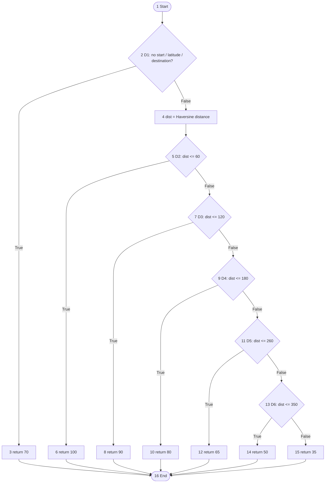

# CeylonTrip Planner – White-Box Testing (Section 3.4)

**Owner:** Nimmitha Idirimana
**Function under test:** `calculateDistanceEfficiency()` – `Server/services/recommendationService.js` (lines 91–111)

---

## 1. Function Under Test

The recommendation engine scores each destination for a trip. This function gives a **distance efficiency score (0–100)**: destinations closer to the starting point get higher scores. It contributes 20 % of the final recommendation score.

**Why this function:** it is part of the core trip-planning logic, it has six decision points, and it is small enough to draw a complete control flow graph.

```js
const calculateDistanceEfficiency = (startLocation, destinationLocation) => {
  if (!startLocation || !startLocation.latitude || !destinationLocation) {   // D1
    return 70;
  }

  const dist = calculateHaversineDistance(
    startLocation.latitude,
    startLocation.longitude,
    destinationLocation.latitude,
    destinationLocation.longitude
  );

  if (dist <= 60) return 100;    // D2
  if (dist <= 120) return 90;    // D3
  if (dist <= 180) return 80;    // D4
  if (dist <= 260) return 65;    // D5
  if (dist <= 350) return 50;    // D6
  return 35;
};
```

---

## 2. Control Flow Graph (CFG)

| Node | Statement |
|---|---|
| 1 | Start |
| 2 | **D1:** `!startLocation \|\| !startLocation.latitude \|\| !destinationLocation` |
| 3 | `return 70` |
| 4 | `dist = calculateHaversineDistance(...)` |
| 5 | **D2:** `dist <= 60` |
| 6 | `return 100` |
| 7 | **D3:** `dist <= 120` |
| 8 | `return 90` |
| 9 | **D4:** `dist <= 180` |
| 10 | `return 80` |
| 11 | **D5:** `dist <= 260` |
| 12 | `return 65` |
| 13 | **D6:** `dist <= 350` |
| 14 | `return 50` |
| 15 | `return 35` |
| 16 | End |



**Edges (E = 21):**
1→2, 2→3 (T), 2→4 (F), 3→16, 4→5, 5→6 (T), 5→7 (F), 6→16, 7→8 (T), 7→9 (F), 8→16, 9→10 (T), 9→11 (F), 10→16, 11→12 (T), 11→13 (F), 12→16, 13→14 (T), 13→15 (F), 14→16, 15→16

---

## 3. Cyclomatic Complexity

| Method | Formula | Calculation | V(G) |
|---|---|---|---|
| Edges and nodes | V(G) = E − N + 2 | 21 − 16 + 2 | **7** |
| Decision (predicate) nodes | V(G) = P + 1 | 6 + 1 | **7** |
| Regions | Enclosed regions + outer region | 6 + 1 | **7** |

**Result: V(G) = 7.** There are 7 linearly independent paths, so **at least 7 test cases** are needed for full branch coverage.

**Note on compound conditions:** D1 contains three conditions (`!startLocation`, `!startLocation.latitude`, `!destinationLocation`). If each condition is counted separately, V(G) = 8 + 1 = **9**, and two extra tests (P1a, P1b below) are needed for **condition coverage**.

**Risk level:** V(G) = 7 is in the 1–10 range – a simple, low-risk, easily testable function.

---

## 4. Independent Paths and Test Cases

Distances were calculated with the project's own `calculateHaversineDistance()` function.

| Path | Route through CFG | Test data (start → destination) | Distance | Expected |
|---|---|---|---|---|
| P1 | 1→2→3→16 | `startLocation = null` → Kandy | – | **70** |
| P2 | 1→2→4→5→6→16 | Colombo (6.9271, 79.8612) → Negombo (7.2083, 79.8358) | 31 km | **100** |
| P3 | …5→7→8→16 | Colombo → Kandy (7.2906, 80.6337) | 94 km | **90** |
| P4 | …7→9→10→16 | Colombo → Ella (6.8667, 81.0466) | 131 km | **80** |
| P5 | …9→11→12→16 | Colombo → Trincomalee (8.5874, 81.2152) | 237 km | **65** |
| P6 | …11→13→14→16 | Colombo → Jaffna (9.6615, 80.0255) | 305 km | **50** |
| P7 | …13→15→16 | Galle (6.0328, 80.2170) → Jaffna | 404 km | **35** |

**Extra tests for condition coverage of D1:**

| Test | Condition made true | Test data | Expected |
|---|---|---|---|
| P1a | `!startLocation.latitude` | `startLocation = { name: 'Colombo' }` (no latitude) → Kandy | **70** |
| P1b | `!destinationLocation` | Colombo → `undefined` | **70** |

---

## 5. Coverage Analysis

| Coverage type | Tests needed | Result with P1–P7 |
|---|---|---|
| **Statement coverage** | Every statement executed at least once | **100 %** – all seven `return` statements and the distance calculation are executed |
| **Branch coverage** | Every decision takes both True and False | **100 %** – see table below |
| **Condition coverage** (D1 only) | Each atomic condition true and false | **100 %** with P1, P1a, P1b + P2 |

| Decision | True branch covered by | False branch covered by |
|---|---|---|
| D1 | P1 | P2–P7 |
| D2 (≤ 60) | P2 | P3–P7 |
| D3 (≤ 120) | P3 | P4–P7 |
| D4 (≤ 180) | P4 | P5–P7 |
| D5 (≤ 260) | P5 | P6–P7 |
| D6 (≤ 350) | P6 | P7 |

---

## 6. Execution

These test cases are automated with **Jest** in `Server/tests/unit/distanceEfficiency.test.js` (Section 3.5).

**Command:** `npm run test:coverage` (run from `Server/`)
**Executed by:** Nimmitha Idirimana | **Result:** Test Suites 1 passed, **Tests 9 passed, 9 total**

| Path | Expected | Actual result | Status |
|---|---|---|---|
| P1 | 70 | 70 | Pass |
| P1a | 70 | 70 | Pass |
| P1b | 70 | 70 | Pass |
| P2 | 100 | 100 | Pass |
| P3 | 90 | 90 | Pass |
| P4 | 80 | 80 | Pass |
| P5 | 65 | 65 | Pass |
| P6 | 50 | 50 | Pass |
| P7 | 35 | 35 | Pass |

### Coverage report

| File | % Stmts | % Branch | % Funcs | % Lines | Uncovered lines |
|---|---|---|---|---|---|
| recommendationService.js | 33.33 | 21.12 | 15.38 | 35.38 | 41–60, 69–84, 118–120, 133–161, 179–201 |

Lines **91–111** (`calculateDistanceEfficiency()`) are **not** in the uncovered lines list, confirming **100 % statement and branch coverage** for the function under test. The helper `calculateHaversineDistance()` (lines 21–34) called by it is also fully covered.

File-level coverage (33 %) is lower because the other functions in the same file are outside the white-box scope:

| Uncovered lines | Function (not in scope) |
|---|---|
| 41–60 | `calculateInterestMatch()` |
| 69–84 | `calculateBudgetCompatibility()` |
| 118–120 | `calculateDurationCompatibility()` |
| 133–161 | `scoreDestination()` |
| 179–201 | `recommendDestinations()` |

**Evidence:** terminal output screenshot and the HTML report `Server/coverage/lcov-report/recommendationService.js.html` (lines 91–111 shown in green).
